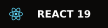
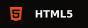
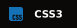
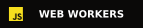
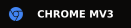
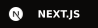
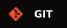
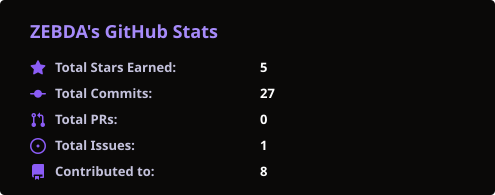
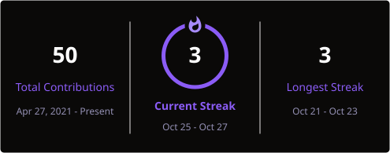
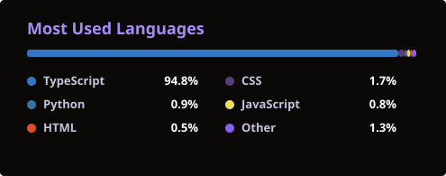

<div align="center">


<br />

<a href="https://github.com/ZEBDA1?tab=followers"></a>
&nbsp;

&nbsp;


</div>

---

## ◉ À propos / About

```ts
const zebda = {
  role: "Full-Stack Developer & Software Creator",
  base: "France 🇫🇷 — available for ambitious projects",
  building: "High-performance client-side web tools & extensions",
  method: ["ideate", "architect", "ship with speed", "polish every pixel"],
  philosophy: "Zero bloat. Privacy by default. Fluid user experience.",
  flagship: [
    "ImmoAlert — Web property search, private tracking & Telegram alerts",
    "PDF Nexus — All-in-one 100% offline PDF power-suite",
    "Revizz — AI-powered revision & spaced repetition platform"
  ],
};
```

Je conçois des applications web modernes, fluides et axées sur la performance et le respect strict de la vie privée.  
Mes projets phares actuels sont **ImmoAlert** (site immobilier auto-hébergé avec 8 sources, comparaison de favoris, suivis privés des logements et alertes Telegram facultatives), **PDF Nexus** (suite PDF 100% locale dans le navigateur) et **Revizz** (plateforme intelligente de révision assistée par IA avec citations sources certifiées).

---

## ◉ Projets Phares / Featured Projects

| # | Projet | Description | Technologies | Statut / Lien |
|---|--------|-------------|--------------|---------------|
| ① | **ImmoAlert** | Site immobilier et bot Telegram : 8 sources, zones de localisation, favoris comparables, notes, visites et rappels privés. | React 19 · TypeScript · Python · aiogram 3 · SQLAlchemy · Scrapling · Docker | [⭐ GitHub](https://github.com/ZEBDA1/ImmoAlert) · [📖 Documentation](https://github.com/ZEBDA1/ImmoAlert#readme) |
| ② | **PDF Nexus** | Extension Chromium tout-en-un & lecteur PDF : édition in-situ, signatures, fusion, conversion multi-formats (Word/Excel), OCR hors-ligne & assistant IA. | React 19 · TypeScript · Vite · PDF.js · pdf-lib · Tesseract.js · Web Workers | [⭐ GitHub](https://github.com/ZEBDA1/pdf-nexus) · [🌐 Chrome Web Store](https://chromewebstore.google.com/detail/dkpcbfafcmhacekpknhklbdkioaoamde) |
| ③ | **Revizz** | Plateforme intelligente de révision : scan OCR de cours manuscrits/PDF, flashcards actives, fiches de synthèse, QCM interactifs et IA Cloudflare sourcée sans hallucination. | Next.js · TypeScript · Cloudflare Workers AI · Llama 3.3 · Tesseract.js · Tailwind | [⭐ GitHub](https://github.com/ZEBDA1/revizz) |

<div align="center">

<a href="https://github.com/ZEBDA1/ImmoAlert"></a>

</div>

---

## ◉ Stack Technique / Tech Stack

**FRONTEND & UI**







**ARCHITECTURE & BROWSER APIS**






**BACKEND, OUTILS & TESTS**








---

## ◉ Statistiques GitHub / Activity

<div align="center">


&nbsp;


<br /><br />



</div>

---

## ◉ Snake Animation

<div align="center">

<picture>
  <source media="(prefers-color-scheme: dark)" srcset="https://raw.githubusercontent.com/ZEBDA1/ZEBDA1/output/github-snake-dark.svg" />
  <source media="(prefers-color-scheme: light)" srcset="https://raw.githubusercontent.com/ZEBDA1/ZEBDA1/output/github-snake.svg" />
  
</picture>

</div>

---

<div align="center">

<p><strong>Des idées ou des projets ambitieux ? Parlons-en !</strong></p>

[](https://discord.com)


</div>
